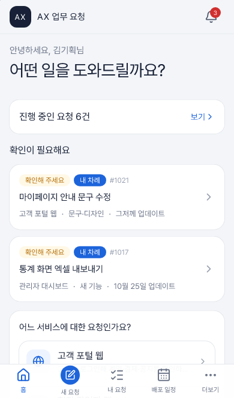
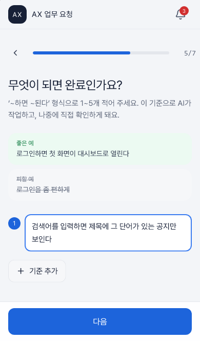
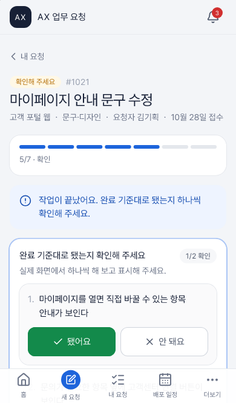
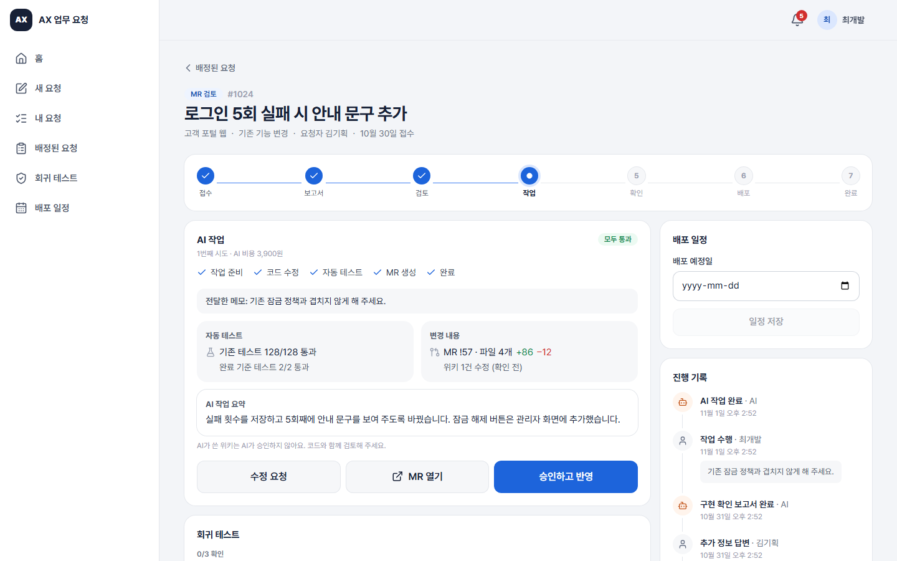
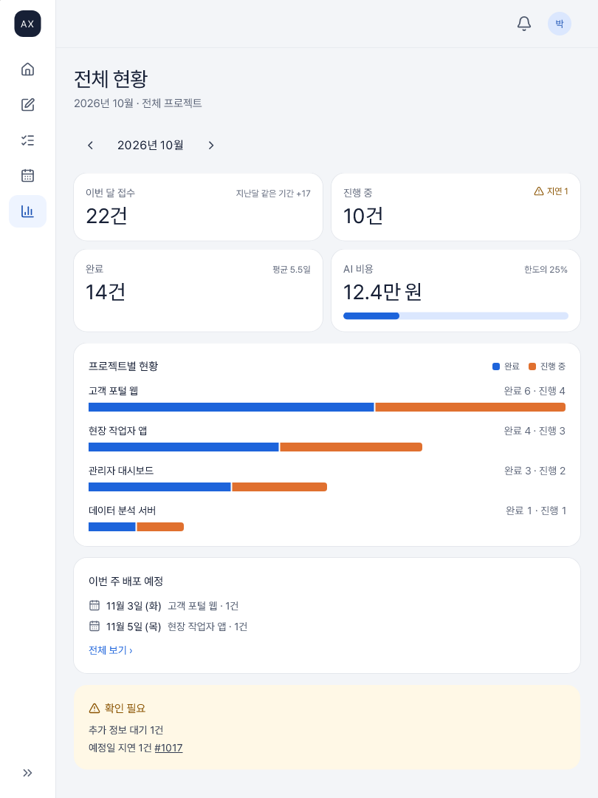
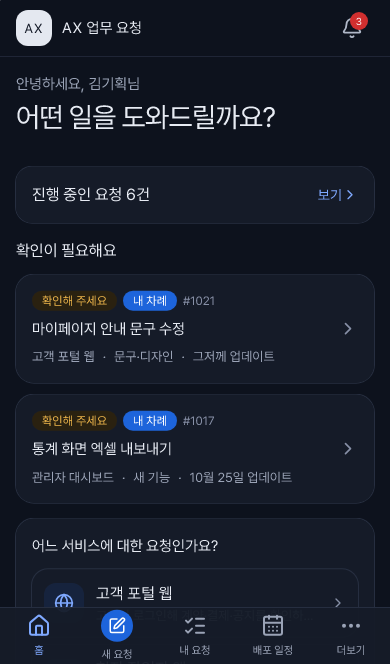
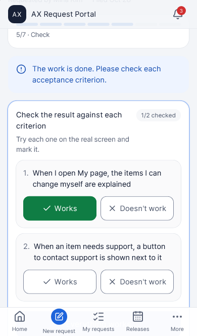
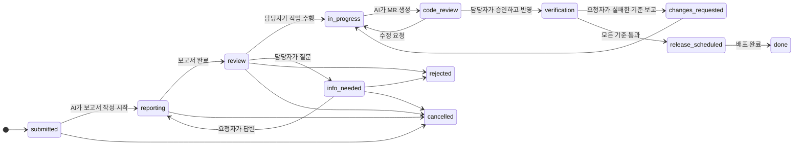

# AX Request Portal

[](https://github.com/Dowon-Kim7949/ax-request-portal/actions/workflows/ci.yml)
[](https://dowon-kim7949.github.io/ax-request-portal/)
[](LICENSE)

[English](README.md) · **한국어**

**AI와 함께 일하는 업무 요청 포털**을 위한 반응형 React 템플릿입니다. 기획, 영업, 경영진처럼 코드를 쓰지 않는 사람이 정해진 형식으로 요청서를 씁니다. AI가 처리할 수 있는지 먼저 검토하고 담당자가 결정하면, AI가 MR(Merge Request)까지 작업합니다. 확인과 배포는 사람이 합니다.

> **실행은 AI, 결정은 사람.** AI는 코드를 합치지 않고, 자기가 고친 위키를 스스로 승인하지 않으며, 사람이 결정해야 하는 단계를 넘어가지 않습니다.

**[라이브 데모](https://dowon-kim7949.github.io/ax-request-portal/)**: 서버 없이 브라우저 안의 목 API로 동작합니다. 요청자, 경영진, 담당자, 관리자 중 하나를 눌러 바로 들어가 보세요(비밀번호 `demo`). 처음 상태로 돌리려면 계정 메뉴의 "데모 데이터 초기화"를 누르면 됩니다. 화면은 한국어와 영어를 지원하고(브라우저 언어를 따르며, 로그인 화면이나 설정에서 바꿀 수 있습니다) 밝은 테마와 어두운 테마가 있습니다.

|                             요청자 홈 (휴대폰)                              |                                  요청서 위저드 (휴대폰)                                   |                                결과 확인 (휴대폰)                                |
| :-------------------------------------------------------------------------: | :---------------------------------------------------------------------------------------: | :------------------------------------------------------------------------------: |
|  |  |  |

|                                       담당자 MR 검토 (PC)                                        |                                경영진 대시보드 (태블릿)                                |
| :----------------------------------------------------------------------------------------------: | :------------------------------------------------------------------------------------: |
|  |  |

|                                 다크 모드 (휴대폰)                                  |                                    영어 (휴대폰)                                    |
| :---------------------------------------------------------------------------------: | :---------------------------------------------------------------------------------: |
|  |  |

## 무엇이 들어 있나

- **모든 화면이 휴대폰, 태블릿, PC에서 끝까지 동작합니다.** 권한 기반 메뉴 표 하나로 휴대폰은 하단 탭, 태블릿은 아이콘 레일, PC는 사이드바를 그립니다. E2E 테스트가 모든 흐름을 세 기기에서 돌리고, 320px 휴대폰과 가로 태블릿도 따로 점검합니다.
- **믿을 수 있는 Request Lifecycle.** 누가 요청을 어디로 옮길 수 있는지를 표 하나가 정합니다. 화면은 이 표를 보고 버튼을 보여 주고, 목 API는 이 표대로 막고, 백엔드는 이 표를 그대로 옮겨 쓰면 됩니다.
- **API 계약 하나, 쓰는 곳 셋.** `src/api/contract.ts`에서 API 클라이언트, 목 API 핸들러, [`docs/openapi.json`](docs/openapi.json)이 모두 나옵니다. 클라이언트가 모든 응답을 계약으로 검증하므로 백엔드가 계약과 어긋나면 바로 드러납니다.
- **백엔드 없이 동작합니다.** 브라우저 안의 목 API(MSW)에 가상의 시연 데이터가 들어 있고, AI 흉내를 내는 시뮬레이터가 몇 초 만에 보고서를 쓰고 MR을 엽니다. 새로고침해도 진행 상황이 이어집니다.
- **비개발자에게는 쉬운 말로.** 요청자에게는 "검토 중 / 추가 정보 필요 / 확인해 주세요"로, 담당자에게는 정확한 상태로 보입니다. 화면 문구는 언어마다 사전 파일 하나에 모여 있습니다.
- **한국어와 영어.** 사용자가 고르기 전까지는 브라우저 언어를 따르고, 날짜와 금액 표기도 함께 바뀝니다. 모든 API 호출에 `Accept-Language`가 붙고, 목 API는 실제 백엔드가 해야 하는 방식대로 그 언어로 답합니다. 오류 메시지, 알림, AI 시뮬레이터의 보고서가 사용자 언어로 옵니다. 두 사전의 키가 어긋나면 타입 검사에서 실패합니다.
- **밝게와 어둡게.** 사용자가 고르지 않으면 시스템 설정을 따릅니다. 앱보다 먼저 `<head>`의 작은 스크립트가 테마를 적용하므로 어두운 화면이 하얗게 번쩍이지 않습니다. 색은 역할별 토큰(글자, 채움, 테두리, 상태)이고 어두운 테마 값을 따로 가집니다. 화면에서 쓰는 글자·컨트롤 색 조합이 두 테마 모두에서 WCAG AA를 지키는지 단위 테스트가 확인합니다.

## Request Lifecycle



전이 표는 [`src/domain/lifecycle.ts`](src/domain/lifecycle.ts)에 있습니다. 단위 테스트가 다음을 확인합니다. 모든 상태에 도달할 수 있는지, 끝나지 않은 상태 중 막다른 곳이 없는지, 이벤트마다 정해진 사람만 일으킬 수 있는지. AI와 시스템 이벤트는 클라이언트에서 받지 않습니다.

## 역할

| 역할   | 할 수 있는 일                                                                                                    |
| ------ | ---------------------------------------------------------------------------------------------------------------- |
| 요청자 | 한 화면에 질문 하나씩 묻는 위저드로 요청서 작성, 담당자 질문에 답변, 완료 기준대로 결과 확인, 배포 일정 보기     |
| 경영진 | 요청자의 모든 기능 + 회사 전체 현황 대시보드                                                                     |
| 담당자 | AI의 구현 확인 보고서 읽기, 작업 수행·정보 요청·반려, AI가 만든 MR 검토, 회귀 테스트 기록, 배포 일정과 배포 완료 |
| 관리자 | 프로젝트(저장소, 위키, 담당자, 대상 화면), 사용자와 역할, AI 비용 한도                                           |

역할은 [`src/domain/roles.ts`](src/domain/roles.ts)의 권한 묶음입니다. 경영진 역할을 없애려면 설정의 `enabledRoles`에서 빼고 `dashboard:view` 권한을 다른 역할에 주면 됩니다.

## 시작하기

GitHub에서 **Use this template**을 누르거나:

```bash
git clone https://github.com/Dowon-Kim7949/ax-request-portal.git
cd ax-request-portal
npm ci
npm run dev
```

출력된 주소를 열고 데모 계정을 고르면 됩니다. Node 22.22.2 이상, 24.15 이상, 26 이상 중 하나가 필요합니다(`.nvmrc`는 24). React Router 8과 jsdom 30이 이 하한을 정하며, CI가 세 줄기의 하한인 22.22.2, 24.15.0, 26.0.0에서 확인합니다.

| 스크립트           | 하는 일                                                         |
| ------------------ | --------------------------------------------------------------- |
| `npm run dev`      | 목 API와 함께 개발 서버 실행                                    |
| `npm run build`    | `dist/`에 배포용 빌드                                           |
| `npm run verify`   | oxlint, Prettier 검사, 타입 검사, 단위 테스트, 빌드 (CI와 같음) |
| `npm run test:e2e` | 휴대폰(WebKit), 태블릿(WebKit), PC(Chromium)에서 Playwright     |
| `npm run openapi`  | 계약을 바꾼 뒤 `docs/openapi.json` 다시 생성                    |

## 내 서비스로 바꾸기

| 바꿀 것                                                               | 위치                                                                                                                    |
| --------------------------------------------------------------------- | ----------------------------------------------------------------------------------------------------------------------- |
| 서비스 이름, 로고 글자, 소개 문구, 사용할 역할, 요청 유형, 목 AI 속도 | [`src/config/app.config.ts`](src/config/app.config.ts) (시작할 때 검증됨)                                               |
| 제공할 언어, 기본 언어                                                | [`src/config/app.config.ts`](src/config/app.config.ts)의 `locales`, `defaultLocale`                                     |
| 색, 모서리, 글꼴                                                      | [`src/index.css`](src/index.css)의 `@theme`(밝게)와 `.dark` 블록. `src/theme.test.ts`가 대비를 검사                     |
| 화면 문구 전부                                                        | [`src/i18n/ko.ts`](src/i18n/ko.ts), [`src/i18n/en.ts`](src/i18n/en.ts)                                                  |
| 누가 무엇을 할 수 있는지                                              | [`src/domain/roles.ts`](src/domain/roles.ts), [`src/domain/lifecycle.ts`](src/domain/lifecycle.ts)                      |
| 시연 데이터                                                           | [`src/mocks/seed.ts`](src/mocks/seed.ts) (실제 상태 전이를 돌려 만들기 때문에 규칙상 불가능한 상태가 들어가지 않습니다) |

### 언어 추가하기

1. `src/i18n/en.ts`를 `src/i18n/<코드>.ts`로 복사해 번역합니다. 한국어 사전을 기준으로 타입이 걸려 있어서 키가 빠지거나 남으면 컴파일 오류가 나고, `src/i18n/i18n.test.ts`가 `{{변수}}`가 빠지지 않았는지 확인합니다.
2. [`src/i18n/locales.ts`](src/i18n/locales.ts)의 `LOCALES`, `LOCALE_LABEL`, `INTL_LOCALE`과 [`src/i18n/index.ts`](src/i18n/index.ts)의 `resources`에 추가합니다.
3. 설정의 `locales`에 넣고 `brand.name`, `brand.tagline`에 그 언어 값을 줍니다.

목 백엔드가 직접 만드는 문구(오류, 알림, AI 시뮬레이터 보고서, 시연 데이터, 제출 전 점검)는 한국어와 영어만 있고, 다른 언어로 요청하면 한국어로 답합니다. 실제 백엔드를 붙이면 모두 백엔드가 대신합니다.

## 실제 백엔드 연결

1. [`docs/openapi.json`](docs/openapi.json)의 엔드포인트를 구현합니다. 요청에는 `POST /auth/login`에서 받은 `Authorization: Bearer <token>`이 붙습니다. 오류 응답은 `ApiError` 형식(`code`, `message`, 선택 `issues`)을 씁니다. 현재 상태에서 할 수 없는 전이는 `409`입니다. 요청에는 `Accept-Language`도 붙으니, 오류 메시지와 알림, AI가 쓰는 글을 그 언어로 돌려주세요.
2. Lifecycle은 서버에서 강제합니다. [`src/domain/lifecycle.ts`](src/domain/lifecycle.ts)와 [`src/domain/report.ts`](src/domain/report.ts)는 브라우저 의존이 없는 순수 TypeScript라서 그대로 옮기거나 가져다 쓸 수 있습니다.
3. AI 작업 두 가지는 서버에서 돌립니다. 구현 확인 보고서(코드와 위키 읽기 전용)와 작업 수행(브랜치 → 테스트 → MR)입니다. 화면은 상태가 `submitted`, `reporting`, `in_progress`인 동안 요청을 주기적으로 다시 불러옵니다.
4. 이렇게 빌드합니다.

   ```bash
   VITE_API_MOCK=false VITE_API_BASE_URL=/api npm run build
   ```

`VITE_API_MOCK=false`이면 목 코드는 아예 불러오지 않습니다. [`.env.example`](.env.example)을 참고하세요.

## nginx로 배포

```bash
npm run build
cp -r dist/* /usr/share/nginx/html/
cp deploy/nginx.conf /etc/nginx/conf.d/ax-request-portal.conf   # server_name, root 수정
nginx -t && nginx -s reload
```

[`deploy/nginx.conf`](deploy/nginx.conf)가 하는 일은 네 가지입니다.

- 모르는 경로를 `index.html`로 보내서 깊은 링크가 동작하게 합니다.
- `/assets/*`는 1년 동안 캐시합니다. 파일 이름에 내용 해시가 들어 있습니다.
- `index.html`과 서비스 워커는 캐시하지 않습니다.
- 없는 자산 파일에는 HTML이 아니라 `404`로 답합니다.

주석으로 `/api` 리버스 프록시 예시와 하위 경로 배포 예시(`VITE_BASE=/ax/`로 빌드)도 넣어 두었습니다. CI의 `nginx` 작업이 이 파일 그대로 `nginx:stable-alpine`에 빌드 결과를 올리고, 위 동작을 [`deploy/check-nginx.sh`](deploy/check-nginx.sh)로 확인합니다.

라이브러리 코드는 고정된 묶음(`vendor-react`, `vendor-router` 등)으로 나뉘어 있습니다. 그래서 앱 코드만 바꿔 배포하면 사용자는 gzip 기준 약 15KB만 새로 받고, 나머지는 브라우저 캐시를 그대로 씁니다. 두 언어의 화면 문구는 별도 `messages` 묶음(gzip 12KB)이라 문구만 고쳐도 앱 코드 캐시는 유지됩니다.

## GitHub Pages 데모

[`.github/workflows/pages.yml`](.github/workflows/pages.yml)이 `main`에 push할 때마다 `VITE_BASE=/<저장소 이름>/`, 목 모드로 빌드해 게시합니다. 이 템플릿으로 만든 저장소에서는 **Settings → Pages → Source**를 **GitHub Actions**로 바꿔 주세요. 사용자 사이트나 사용자 도메인이면 `VITE_BASE`를 `/`로 둡니다.

Pages에는 SPA fallback이 없어서 워크플로가 `index.html`을 `404.html`로 복사합니다. 그래서 `/requests/1024` 같은 깊은 링크는 올바른 화면을 열지만 HTTP 상태는 `404`입니다. 브라우저에서는 정상으로 보이지만, 링크 검사기와 크롤러는 없는 페이지로 판단합니다. nginx 배포는 같은 경로에 `200`으로 답합니다.

## 폴더 구성

```
src/
  domain/      lifecycle, 역할, 모델(Zod), 보고서·제출 점검 규칙
  api/         계약, 타입이 있는 클라이언트, TanStack Query 훅, OpenAPI 생성기
  mocks/       브라우저 안 백엔드: 엔진, AI 시뮬레이터, 시연 데이터, MSW 핸들러, 서버 문구
  config/      템플릿 설정과 빌드 시 환경 변수
  app/         라우터, 권한 가드, 반응형 화면 틀, 내비게이션, 테마와 언어
  components/  UI 기본 컴포넌트(Radix 기반)와 요청 관련 컴포넌트
  features/    화면별 폴더
  i18n/        화면 문구, 언어마다 사전 하나
e2e/           Playwright 테스트 (세 기기에서 실행)
deploy/        nginx 설정과 검사 스크립트
docs/          openapi.json, README 이미지
```

## 품질 검사

- `npm run verify`: 경고도 실패로 보는 oxlint, Prettier, 엄격한 TypeScript(`noUncheckedIndexedAccess`), 단위 테스트 156개(두 테마의 WCAG 대비, 두 사전의 키 일치 포함), 배포용 빌드.
- E2E: 휴대폰, 태블릿, PC에서 94개. 모든 흐름을 세 기기에서 돌리고, 네 역할의 주요 화면 전부를 320px 휴대폰(두 언어 모두)과 가로 태블릿에서 점검합니다. 따로 영어로 각 역할의 화면을 돌며 한국어가 남아 있으면 실패시키고, 다크 모드로도 돌립니다. 가로 스크롤은 데이터가 다 그려진 뒤에 검사합니다.
- CI가 push와 PR마다 verify, E2E, nginx 검사를 돌립니다. Dependabot이 의존성과 Actions 버전을 최신으로 유지합니다.

## 알려진 한계

- 목 모드의 로그인은 시연 계정이면 데모 비밀번호로 누구든 들어갈 수 있습니다. 실제 인증은 백엔드의 몫입니다.
- 메일과 메신저 알림은 설정만 저장합니다. 실제 발송은 백엔드가 합니다.
- 시연 데이터는 만들어질 때의 언어로 쓰여 있습니다. 손대지 않은 데이터는 언어를 바꾸면 따라 바뀌지만, 무언가 바꾼 뒤에는 쓰인 그대로 남습니다. "데모 데이터 초기화"를 누르면 현재 언어로 다시 만듭니다. 사용자가 쓴 글은 번역하지 않습니다.
- 오른쪽에서 왼쪽으로 쓰는 언어는 고려하지 않았습니다.

## 라이선스

[MIT](LICENSE)
