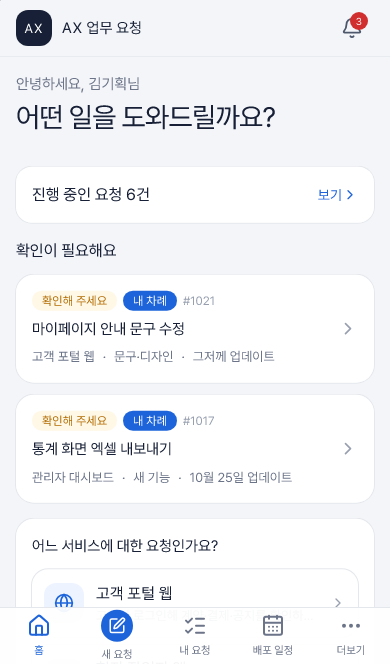
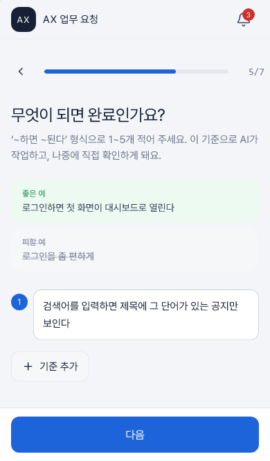
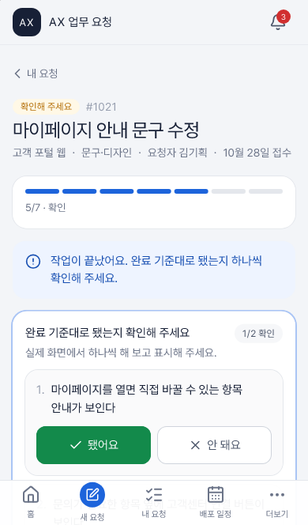
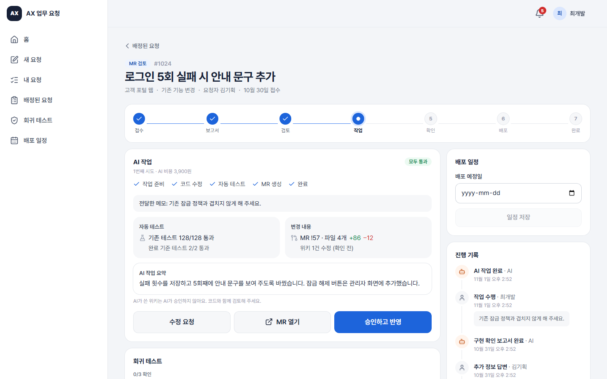
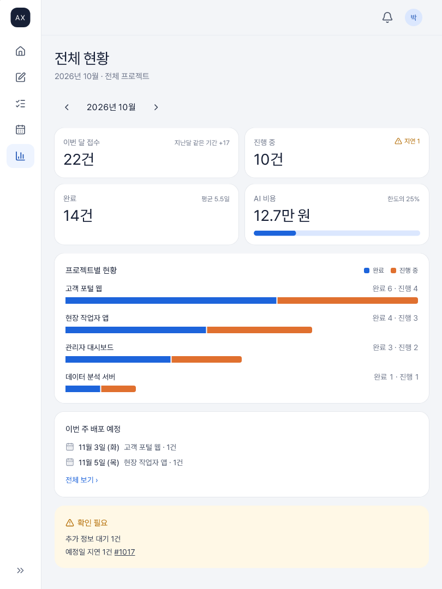
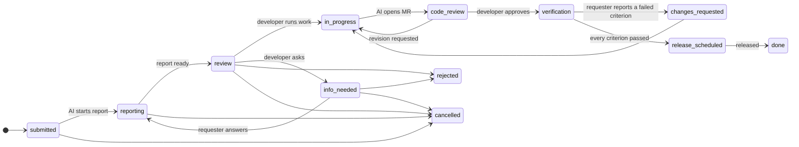

# AX Request Portal

[](https://github.com/Dowon-Kim7949/ax-request-portal/actions/workflows/ci.yml)
[](https://dowon-kim7949.github.io/ax-request-portal/)
[](LICENSE)

**English** · [한국어](README.ko.md)

A responsive React template for an **AI-assisted work request portal**. People who don't write code (planning, sales, management) file structured requests. An AI checks whether each request can be done, a developer decides, the AI does the work up to a merge request, and people verify and release it.

> **AI executes, people decide.** The AI never merges, never approves its own wiki edits, and never moves a request past a human checkpoint.

**[Live demo](https://dowon-kim7949.github.io/ax-request-portal/)**: runs entirely in your browser against a mock API. Sign in with one tap as requester, executive, developer or admin (password `demo`). Use "reset demo data" in the account menu to start over.

|                                 Requester (phone)                                  |                                           Wizard (phone)                                            |                                           QA checklist (phone)                                           |
| :--------------------------------------------------------------------------------: | :-------------------------------------------------------------------------------------------------: | :------------------------------------------------------------------------------------------------------: |
|  |  |  |

|                                           Developer review (desktop)                                           |                             Executive dashboard (tablet)                              |
| :------------------------------------------------------------------------------------------------------------: | :-----------------------------------------------------------------------------------: |
|  |  |

## What's inside

- **Every screen works on phones, tablets and desktops.** One permission-driven nav table renders a tab bar on phones, an icon rail on tablets and a sidebar on desktops. The e2e suite runs every flow on all three, plus a 320 px phone and a landscape tablet.
- **A request lifecycle you can trust.** One transition table decides who can move a request where. The UI shows buttons from it, the mock API enforces it, and a backend can port it as-is.
- **One API contract, three consumers.** `src/api/contract.ts` produces the typed client, the mock API handlers and [`docs/openapi.json`](docs/openapi.json). The client validates every response, so a drifting backend fails loudly.
- **Works with no backend.** An in-browser mock API (MSW) with fictional demo data and a simulated AI that writes reports and opens merge requests in seconds. Progress survives reloads.
- **Plain language for non-developers.** Requesters see "checking / needs your answer / please check the result". Developers see the precise state. All copy lives in one dictionary.

## Request lifecycle



The table lives in [`src/domain/lifecycle.ts`](src/domain/lifecycle.ts). Unit tests check that every status is reachable, no open status is a dead end, and only the right person can fire each event. AI and system events are never accepted from clients.

## Roles

| Role      | Can                                                                                                                                                                  |
| --------- | -------------------------------------------------------------------------------------------------------------------------------------------------------------------- |
| Requester | File requests through a one-question-per-screen wizard, answer the developer's questions, check the result against the acceptance criteria, see the release schedule |
| Executive | Everything a requester can, plus the company-wide dashboard                                                                                                          |
| Developer | Read the AI's feasibility report, run the AI, ask or reject, review the AI's merge request, record regression checks, schedule and mark releases                     |
| Admin     | Projects (repository, wiki, owners, screens), users and roles, AI cost limits                                                                                        |

Roles are permission sets in [`src/domain/roles.ts`](src/domain/roles.ts). To drop the executive role, remove it from `enabledRoles` in the config and give `dashboard:view` to someone else.

## Getting started

Click **Use this template** on GitHub, or:

```bash
git clone https://github.com/Dowon-Kim7949/ax-request-portal.git
cd ax-request-portal
npm ci
npm run dev
```

Open the printed URL and pick a demo account. Node 20.19+ is required (`.nvmrc` pins 22).

| Script             | What it does                                                         |
| ------------------ | -------------------------------------------------------------------- |
| `npm run dev`      | Dev server with the mock API                                         |
| `npm run build`    | Production build into `dist/`                                        |
| `npm run verify`   | oxlint, Prettier check, typecheck, unit tests, build (what CI runs)  |
| `npm run test:e2e` | Playwright on phone (WebKit), tablet (WebKit) and desktop (Chromium) |
| `npm run openapi`  | Regenerate `docs/openapi.json` after changing the contract           |

## Make it yours

| Change                                                                       | Where                                                                                                                 |
| ---------------------------------------------------------------------------- | --------------------------------------------------------------------------------------------------------------------- |
| Name, short logo text, tagline, enabled roles, request types, mock AI timing | [`src/config/app.config.ts`](src/config/app.config.ts) (validated at startup)                                         |
| Colors, radius, font                                                         | `@theme` block in [`src/index.css`](src/index.css)                                                                    |
| Every piece of UI text                                                       | [`src/i18n/ko.ts`](src/i18n/ko.ts). Add a language by copying it with the same keys                                   |
| Who can do what                                                              | [`src/domain/roles.ts`](src/domain/roles.ts) and [`src/domain/lifecycle.ts`](src/domain/lifecycle.ts)                 |
| Demo data                                                                    | [`src/mocks/seed.ts`](src/mocks/seed.ts) (built by running the real lifecycle, so it can't contain impossible states) |

## Connect a real backend

1. Implement the endpoints in [`docs/openapi.json`](docs/openapi.json). Requests carry `Authorization: Bearer <token>` from `POST /auth/login`. Errors use the `ApiError` body (`code`, `message`, optional `issues`). A transition that doesn't fit the current status is a `409`.
2. Enforce the lifecycle on the server. [`src/domain/lifecycle.ts`](src/domain/lifecycle.ts) and [`src/domain/report.ts`](src/domain/report.ts) are plain TypeScript with no browser dependency. Port them or import them.
3. Run the two AI jobs server-side: the feasibility report (read-only access to the code and wiki) and the work run (branch → tests → merge request). The UI polls a request while its status is `submitted`, `reporting` or `in_progress`.
4. Build against it:

   ```bash
   VITE_API_MOCK=false VITE_API_BASE_URL=/api npm run build
   ```

With `VITE_API_MOCK=false` the mock code is never loaded. See [`.env.example`](.env.example).

## Deploy with nginx

```bash
npm run build
cp -r dist/* /usr/share/nginx/html/
cp deploy/nginx.conf /etc/nginx/conf.d/ax-request-portal.conf   # set server_name, root
nginx -t && nginx -s reload
```

[`deploy/nginx.conf`](deploy/nginx.conf) does four things:

- sends unknown paths to `index.html` so deep links work;
- caches `/assets/*` for a year (file names are content-hashed);
- never caches `index.html` or the service worker;
- answers a missing asset with `404` instead of HTML.

It also has a commented `/api` reverse proxy and a sub-path variant (build with `VITE_BASE=/ax/`). The CI `nginx` job serves the build with this exact file in `nginx:stable-alpine` and checks all of the above with [`deploy/check-nginx.sh`](deploy/check-nginx.sh).

Vendor code is split into stable chunks (`vendor-react`, `vendor-router`, …), so an app-only release changes about 17 KB gzip and browsers keep the rest cached.

## GitHub Pages demo

[`.github/workflows/pages.yml`](.github/workflows/pages.yml) builds in mock mode with `VITE_BASE=/<repository>/` and publishes on every push to `main`. In a repository made from this template, set **Settings → Pages → Source** to **GitHub Actions**. For a user site or a custom domain, set `VITE_BASE` to `/`.

## Project layout

```
src/
  domain/      lifecycle, roles, models (Zod), report and precheck rules
  api/         contract, typed client, TanStack Query hooks, OpenAPI builder
  mocks/       in-browser backend: engine, simulated AI, seed, MSW handlers
  config/      template config and build-time env
  app/         router, guards, responsive shell, navigation
  components/  ui primitives (Radix-based) and request widgets
  features/    one folder per screen
  i18n/        UI copy
e2e/           Playwright specs (run on three viewports)
deploy/        nginx config and its checks
docs/          openapi.json, README images
```

## Quality gates

- `npm run verify`: oxlint with warnings as errors, Prettier, strict TypeScript (`noUncheckedIndexedAccess`), 51 unit tests, production build.
- E2E: 16 flows × 3 viewports, plus every main screen of every role at 320 px and on a landscape tablet. Horizontal overflow is checked after data has loaded.
- CI runs verify, e2e and the nginx check on every push and pull request. Dependabot keeps dependencies and actions current.

## Known limits

- Sign-in in mock mode accepts the demo password for any seeded account. Real authentication belongs to your backend.
- E-mail and messenger notifications are only preferences here. Sending them is the backend's job.
- The UI ships in Korean only. The i18n structure is ready for more languages.
- No dark mode yet.

## License

[MIT](LICENSE)
