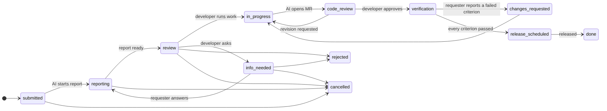

# AX Request Portal

[](https://github.com/Dowon-Kim7949/ax-request-portal/actions/workflows/ci.yml)
[](https://dowon-kim7949.github.io/ax-request-portal/)
[](LICENSE)

**English** · [한국어](README.ko.md)

A responsive React template for an **AI-assisted work request portal**. People who don't write code (planning, sales, management) file structured requests. An AI checks whether each request can be done, a developer decides, the AI does the work up to a merge request, and people verify and release it.

> **AI executes, people decide.** The AI never merges, never approves its own wiki edits, and never moves a request past a human checkpoint.

**[Live demo](https://dowon-kim7949.github.io/ax-request-portal/)**: runs entirely in your browser against a mock API. Sign in with one tap as requester, executive, developer or admin (password `demo`). Use "reset demo data" in the account menu to start over. The demo speaks English or Korean (it follows your browser; switch on the sign-in screen or in Settings) and has light and dark themes.

|                                 Requester (phone)                                  |                                           Wizard (phone)                                            |                                           QA checklist (phone)                                           |
| :--------------------------------------------------------------------------------: | :-------------------------------------------------------------------------------------------------: | :------------------------------------------------------------------------------------------------------: |
|  |  |  |

|                                           Developer review (desktop)                                           |                             Executive dashboard (tablet)                              |
| :------------------------------------------------------------------------------------------------------------: | :-----------------------------------------------------------------------------------: |
|  |  |

|                                     Dark mode (phone)                                     |                                       English (phone)                                       |
| :---------------------------------------------------------------------------------------: | :-----------------------------------------------------------------------------------------: |
|  |  |

## What's inside

- **Every screen works on phones, tablets and desktops.** One permission-driven nav table renders a tab bar on phones, an icon rail on tablets and a sidebar on desktops. The e2e suite runs every flow on all three, plus a 320 px phone and a landscape tablet.
- **A request lifecycle you can trust.** One transition table decides who can move a request where. The UI shows buttons from it, the mock API enforces it, and a backend can port it as-is.
- **One API contract, three consumers.** `src/api/contract.ts` produces the typed client, the mock API handlers and [`docs/openapi.json`](docs/openapi.json). The client validates every response, so a drifting backend fails loudly.
- **Works with no backend.** An in-browser mock API (MSW) with fictional demo data and a simulated AI that writes reports and opens merge requests in seconds. Progress survives reloads.
- **Plain language for non-developers.** Requesters see "checking / needs your answer / please check the result". Developers see the precise state. All copy lives in one dictionary per language.
- **English and Korean.** The language follows the browser until the user picks one. Dates and amounts follow it too. Every API call sends `Accept-Language`, and the mock API answers in it the way a real backend should: errors, notifications and the simulated AI's reports come back in the user's language. The type checker fails if the two dictionaries drift apart.
- **Light and dark.** The theme follows the system unless the user chooses one. It is applied by a tiny script in `<head>` before the app loads, so a dark page never flashes white. Colors are role tokens (text, fill, border, status) with their own dark values, and a unit test checks the text and control color pairs the UI uses against WCAG AA in both themes.

## Request lifecycle



The table lives in [`src/domain/lifecycle.ts`](src/domain/lifecycle.ts). Unit tests check that every status is reachable, no open status is a dead end, and only the right person can fire each event. AI and system events are never accepted from clients.

## Roles

| Role      | Can                                                                                                                                                                  |
| --------- | -------------------------------------------------------------------------------------------------------------------------------------------------------------------- |
| Requester | File requests through a one-question-per-screen wizard, answer the developer's questions, check the result against the acceptance criteria, see the release schedule |
| Executive | Everything a requester can, plus the company-wide dashboard                                                                                                          |
| Developer | Read the AI's feasibility report, run the AI, ask or reject, review the AI's merge request, record regression checks, schedule and mark releases                     |
| Admin     | Projects (repository, wiki, owners, screens), users and roles, AI cost limits                                                                                        |

Roles are permission sets in [`src/domain/roles.ts`](src/domain/roles.ts). To drop the executive role, remove it from `enabledRoles` in the config and give `dashboard:view` to someone else.

## Getting started

Click **Use this template** on GitHub, or:

```bash
git clone https://github.com/Dowon-Kim7949/ax-request-portal.git
cd ax-request-portal
npm ci
npm run dev
```

Open the printed URL and pick a demo account. Node 22.22.2+ or 24.15+ is required (`.nvmrc` pins 22; React Router 8 and jsdom 30 set that floor). CI checks the floor of each line: 22.22.2 and 24.15.0.

| Script             | What it does                                                         |
| ------------------ | -------------------------------------------------------------------- |
| `npm run dev`      | Dev server with the mock API                                         |
| `npm run build`    | Production build into `dist/`                                        |
| `npm run verify`   | oxlint, Prettier check, typecheck, unit tests, build (what CI runs)  |
| `npm run test:e2e` | Playwright on phone (WebKit), tablet (WebKit) and desktop (Chromium) |
| `npm run openapi`  | Regenerate `docs/openapi.json` after changing the contract           |

## Make it yours

| Change                                                                       | Where                                                                                                                 |
| ---------------------------------------------------------------------------- | --------------------------------------------------------------------------------------------------------------------- |
| Name, short logo text, tagline, enabled roles, request types, mock AI timing | [`src/config/app.config.ts`](src/config/app.config.ts) (validated at startup)                                         |
| Offered languages and the fallback language                                  | `locales` and `defaultLocale` in [`src/config/app.config.ts`](src/config/app.config.ts)                               |
| Colors, radius, font                                                         | `@theme` (light) and `.dark` blocks in [`src/index.css`](src/index.css), checked by `src/theme.test.ts`               |
| Every piece of UI text                                                       | [`src/i18n/en.ts`](src/i18n/en.ts) and [`src/i18n/ko.ts`](src/i18n/ko.ts)                                             |
| Who can do what                                                              | [`src/domain/roles.ts`](src/domain/roles.ts) and [`src/domain/lifecycle.ts`](src/domain/lifecycle.ts)                 |
| Demo data                                                                    | [`src/mocks/seed.ts`](src/mocks/seed.ts) (built by running the real lifecycle, so it can't contain impossible states) |

### Add a language

1. Copy `src/i18n/en.ts` to `src/i18n/<code>.ts` and translate it. It is typed against the Korean dictionary, so a missing or extra key is a compile error, and `src/i18n/i18n.test.ts` checks that every `{{placeholder}}` survives.
2. Add the code to `LOCALES`, `LOCALE_LABEL` and `INTL_LOCALE` in [`src/i18n/locales.ts`](src/i18n/locales.ts), and to `resources` in [`src/i18n/index.ts`](src/i18n/index.ts).
3. Add it to `locales` and give `brand.name` and `brand.tagline` a value for it in the config.

The mock backend's own texts (errors, notifications, simulated AI reports, demo data, the submission check) exist in English and Korean only, and fall back to Korean for other languages. A real backend replaces all of them.

## Connect a real backend

1. Implement the endpoints in [`docs/openapi.json`](docs/openapi.json). Requests carry `Authorization: Bearer <token>` from `POST /auth/login`. Errors use the `ApiError` body (`code`, `message`, optional `issues`). A transition that doesn't fit the current status is a `409`. Requests also carry `Accept-Language`: write error messages, notifications and AI text in that language.
2. Enforce the lifecycle on the server. [`src/domain/lifecycle.ts`](src/domain/lifecycle.ts) and [`src/domain/report.ts`](src/domain/report.ts) are plain TypeScript with no browser dependency. Port them or import them.
3. Run the two AI jobs server-side: the feasibility report (read-only access to the code and wiki) and the work run (branch → tests → merge request). The UI polls a request while its status is `submitted`, `reporting` or `in_progress`.
4. Build against it:

   ```bash
   VITE_API_MOCK=false VITE_API_BASE_URL=/api npm run build
   ```

With `VITE_API_MOCK=false` the mock code is never loaded. See [`.env.example`](.env.example).

## Deploy with nginx

```bash
npm run build
cp -r dist/* /usr/share/nginx/html/
cp deploy/nginx.conf /etc/nginx/conf.d/ax-request-portal.conf   # set server_name, root
nginx -t && nginx -s reload
```

[`deploy/nginx.conf`](deploy/nginx.conf) does four things:

- sends unknown paths to `index.html` so deep links work;
- caches `/assets/*` for a year (file names are content-hashed);
- never caches `index.html` or the service worker;
- answers a missing asset with `404` instead of HTML.

It also has a commented `/api` reverse proxy and a sub-path variant (build with `VITE_BASE=/ax/`). The CI `nginx` job serves the build with this exact file in `nginx:stable-alpine` and checks all of the above with [`deploy/check-nginx.sh`](deploy/check-nginx.sh).

Vendor code is split into stable chunks (`vendor-react`, `vendor-router`, …), so an app-only release changes about 15 KB gzip and browsers keep the rest cached. UI copy for both languages has its own `messages` chunk (12 KB gzip), so a wording change doesn't invalidate app code either.

## GitHub Pages demo

[`.github/workflows/pages.yml`](.github/workflows/pages.yml) builds in mock mode with `VITE_BASE=/<repository>/` and publishes on every push to `main`. In a repository made from this template, set **Settings → Pages → Source** to **GitHub Actions**. For a user site or a custom domain, set `VITE_BASE` to `/`.

Pages has no SPA fallback, so the workflow copies `index.html` to `404.html`. A deep link such as `/requests/1024` therefore opens the right screen but with HTTP status `404`: browsers show it normally, while link checkers and crawlers report it as missing. The nginx deployment answers the same path with `200`.

## Project layout

```
src/
  domain/      lifecycle, roles, models (Zod), report and precheck rules
  api/         contract, typed client, TanStack Query hooks, OpenAPI builder
  mocks/       in-browser backend: engine, simulated AI, seed, MSW handlers, server texts
  config/      template config and build-time env
  app/         router, guards, responsive shell, navigation, theme and language
  components/  ui primitives (Radix-based) and request widgets
  features/    one folder per screen
  i18n/        UI copy, one dictionary per language
e2e/           Playwright specs (run on three viewports)
deploy/        nginx config and its checks
docs/          openapi.json, README images
```

## Quality gates

- `npm run verify`: oxlint with warnings as errors, Prettier, strict TypeScript (`noUncheckedIndexedAccess`), 156 unit tests (including WCAG contrast in both themes and dictionary parity), production build.
- E2E: 94 tests on phone, tablet and desktop. Every flow runs on all three. Every main screen of every role is checked at 320 px (in both languages) and on a landscape tablet. Separate runs walk each role's screens in English, failing on any leftover Korean, and in dark mode. Horizontal overflow is checked after data has loaded.
- CI runs verify, e2e and the nginx check on every push and pull request. Dependabot keeps dependencies and actions current.

## Known limits

- Sign-in in mock mode accepts the demo password for any seeded account. Real authentication belongs to your backend.
- E-mail and messenger notifications are only preferences here. Sending them is the backend's job.
- Demo data is written in the language that was active when it was created. Untouched data follows a language switch; once you change something it stays as written, and "reset demo data" rebuilds it in the current language. User-written text is never translated.
- Right-to-left languages are not handled.

## License

[MIT](LICENSE)
